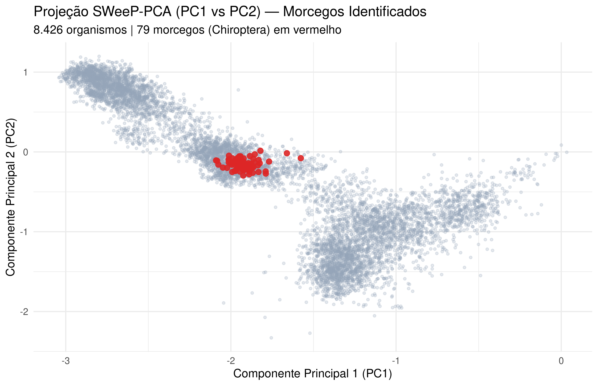
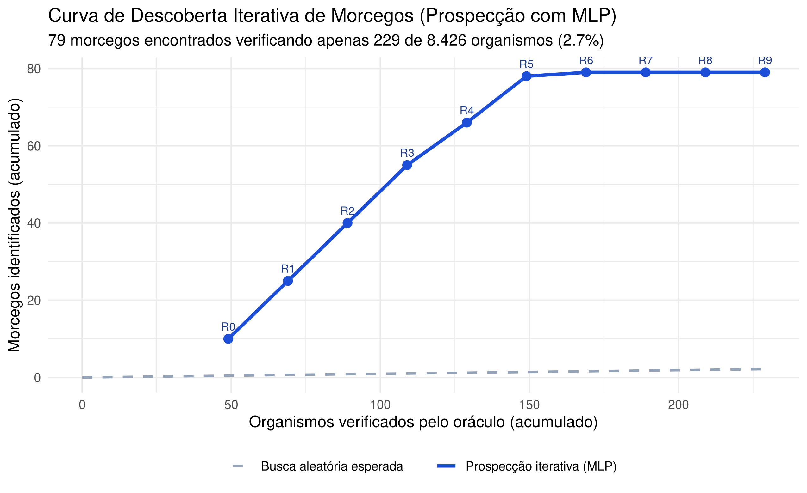
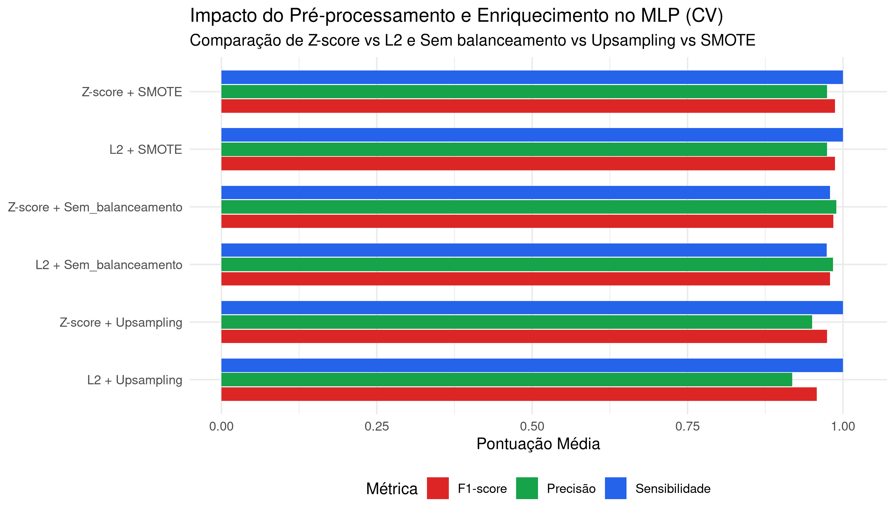
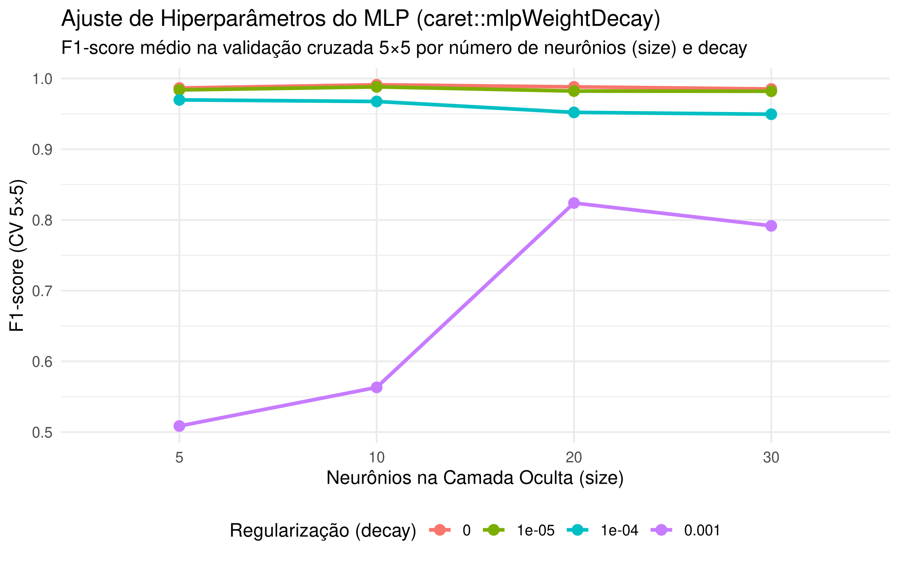
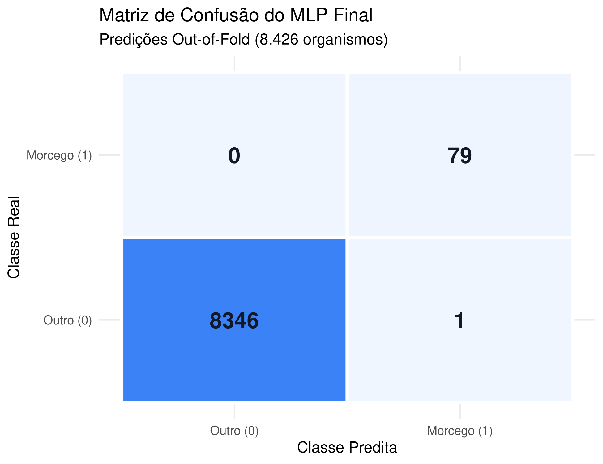
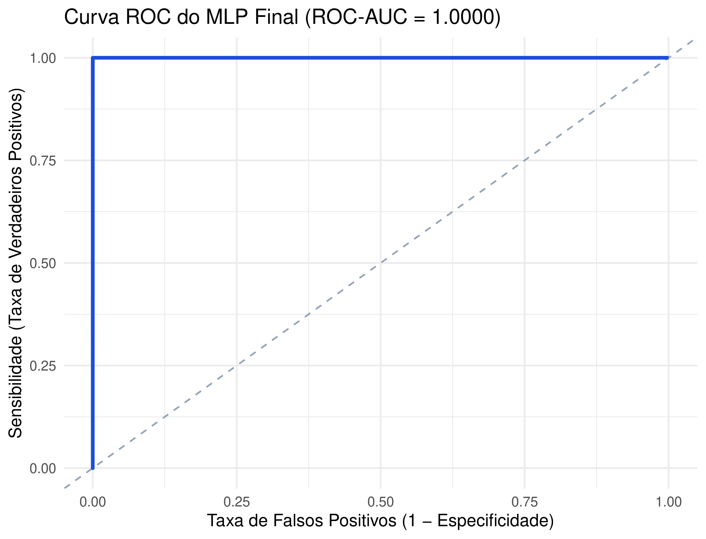

# Reconhecimento de Padrões – É morcego?

**Equipe:** João Gabriel Fanti, João Victor Leal Gonçalves, João Pedro Nossol e Lucas Santana  
**Disciplina:** Inteligência Computacional Aplicada I – DS803 (SEPT – TADS – UFPR)  
**Docente:** Prof. Dr. Roberto Tadeu Raittz  

---

## Resumo

Este trabalho aplica técnicas de reconhecimento de padrões e aprendizado de máquina em R (`caret` + `RSNNS::mlpWeightDecay`) para identificar todas as espécies de morcegos (ordem *Chiroptera*) em um conjunto de **8.426 organismos** descritos por 50 características numéricas obtidas via projeção SWeeP e Análise de Componentes Principais (`wpc50.dat`), acompanhadas dos respectivos nomes científicos (`Names.txt`). Como o conjunto inicial não possui rótulos, desenvolveu-se uma estratégia de supervisão iterativa (*active learning* com oráculo humano em console) iniciada a partir de 49 sementes balanceadas (10 morcegos cobrindo ambas as subordens e 39 não-morcegos estratificados). Em apenas 8 rodadas guiadas pelo MLP e 1 varredura de sanidade por distância cosseno — verificando **229 organismos (2,7% da base)** — foram identificados **79 morcegos** distribuídos em **32 gêneros**. Para mitigar o desbalanceamento severo (~0,94% de positivos), compararam-se estratégias de enriquecimento da base de treinamento dentro da validação cruzada, destacando-se o **SMOTE** com padronização Z-score. O classificador final **MLP (`size = 10`, `decay = 0`)** alcançou na validação cruzada 5×5 **sensibilidade de 100,00%**, **precisão de 98,29% ± 3,11%**, **acurácia de 99,98% ± 0,03%**, **especificidade de 99,98%** e **F1-score de 0,9911**. No conjunto de teste *holdout* (20% não visto), obteve **100,00% de sensibilidade**, **93,75% de precisão** e **99,94% de acurácia**; nas predições *out-of-fold* sobre todos os 8.426 organismos, obteve **0 falsos negativos** e apenas **1 falso positivo** (`Hylomys_suillus`, mamífero da ordem irmã *Eulipotyphla*).

---

## 1. Apresentação e Introdução

O Reconhecimento de Padrões (RP) trata da descrição e classificação computacional de medidas numéricas que representam objetos de um domínio (SCHALKOFF, 1992). No contexto da bioinformática, sequências biológicas possuem comprimentos variáveis e alta dimensionalidade, exigindo etapas prévias de extração de características e redução de dimensionalidade para possibilitar o uso de classificadores vetoriais.

Os arquivos fornecidos neste trabalho — `wpc50.dat` e `Names.txt` — contêm, respectivamente, vetores de 50 características contínuas e os nomes científicos de **8.426 organismos**. Esses padrões derivam da técnica **SWeeP** (*Spaced Words Projection*), que projeta proteomas mitocondriais completos de um espaço de alta dimensão (~160.000 *k-mers*) para 600 dimensões mediante matriz ortonormal aleatória (DE PIERRI et al., 2020), seguida de **Análise de Componentes Principais (PCA)** retendo as 50 primeiras componentes (`wpc50.dat`). Na verificação inicial (`R/01_exploracao.R`), confirmou-se ausência total de valores ausentes ou não finitos, correspondência exata 1-para-1 entre as 8.426 linhas (índices de ordem `1..8426`), redução progressiva do desvio-padrão ao longo das componentes (`SD(PC01) = 0,7153`, `SD(PC02) = 0,8347` até `SD(PC50) = 0,1684`) e ampla variação da norma Euclidiana L2 dos vetores (`mínimo = 0,1454`, `mediana = 2,8309`, `máximo = 9,4664`).

O objetivo central do trabalho é identificar **todos os morcegos** (ordem *Chiroptera*) presentes na lista de 8.426 organismos por meio de um processo iterativo de aprendizado de máquina, disponibilizar a classificação completa (`1` = Morcego; `0` = Outro) e os índices positivos, justificar a escolha do classificador e avaliar estatisticamente o desempenho do modelo final. Todo o fluxo foi implementado em **R 4.5.0** utilizando os pacotes `caret` (KUHN, 2008), `RSNNS` (BERGMEIR; BENÍTEZ, 2012), `smotefamily`, `pROC`, `MLmetrics` e `ggplot2`.

---

## 2. Estratégias Utilizadas para a Classificação dos Padrões

### 2.1 Estratégia de Supervisão Iterativa (Prospecção Ativa)

Inspecionar manualmente todos os 8.426 nomes científicos seria ineficiente e contrário à proposta do trabalho. Em vez disso, adotou-se uma estratégia de **aprendizado ativo iterativo** (`R/02_prospeccao_mlp.R`), com verificação taxonômica manual no console do RStudio registrada de forma auditável em `estado/rotulos_oraculo.csv` e `estado/historico_rodadas.csv`:

1. **Rodada 0 — Sementes preliminares (49 organismos):**
   - **10 morcegos positivos (`classe = 1`)**, escolhidos deliberadamente para cobrir **ambas as subordens de *Chiroptera*** e evitar viés de amostragem (*overfitting* por conjunto pouco representativo): *Yinpterochiroptera* (`Pteropus_alecto`, `Cynopterus_brachyotis`, `Rousettus_aegyptiacus`, `Rhinolophus_formosae`, `Hipposideros_armiger`) e *Yangochiroptera* (`Myotis_bechsteinii`, `Artibeus_jamaicensis`, `Desmodus_rotundus`, `Pipistrellus_abramus`, `Tadarida_teniotis`).
   - **39 não-morcegos negativos (`classe = 0`)**, estratificados entre fungos, plantas, artrópodes, moluscos, peixes, anfíbios, répteis, aves e **mamíferos não-morcegos** (monotremados, marsupiais, primatas, roedores, carnívoros, ungulados, cetáceos e *Eulipotyphla*). A presença de mamíferos próximos desde a Rodada 0 impede que o classificador aprenda apenas "mamífero vs. não-mamífero".

2. **Rodadas 1 a 8 — Prospecção guiada por MLP (`mlpWeightDecay`):**
   - A cada rodada, um MLP (`caret::train(..., method = "mlpWeightDecay")`) foi treinado sobre os vetores L2-normalizados (`X_l2`, padronizados com `center` e `scale` e balanceados via `sampling = "up"`) do conjunto já verificado, estimando `P(Morcego)` para todos os organismos ainda não rotulados.
   - Foram selecionados **20 candidatos por rodada**: **15 de maior probabilidade (`alta`)** para descoberta rápida de novos morcegos, e **5 de maior incerteza (`fronteira`, `|P - 0,5|` mínimo)** para capturar tanto famílias divergentes de morcegos quanto *hard negatives* (mamíferos evolutivamente vizinhos) que refinam a fronteira de decisão.

3. **Critério de Parada e Varredura de Sanidade (Rodada 9):**
   - O processo atingiu convergência após **2 rodadas consecutivas sem novos morcegos** (Rodadas 7 e 8, nas quais as probabilidades máximas caíram para `≤ 0,339`, dominadas por musaranhos, toupeiras e mustelídeos).
   - Como confirmação independente do modelo neural, executou-se uma **varredura de sanidade** (Rodada 9) sobre os 20 organismos não rotulados com menor distância cosseno aos 79 morcegos confirmados (`Mogera`, `Uropsilus`, `Galemys`, rinocerontes, camelos e focas), resultando em **0 novos morcegos**. Os 8.197 organismos restantes não consultados receberam classe `0`.

| Rodada | Tipo | Consultados | Novos Morcegos | Novos Outros | Acumulado Morcegos | Acumulado Verificados |
| :---: | :--- | :---: | :---: | :---: | :---: | :---: |
| 0 | Sementes | 49 | 10 | 39 | 10 | 49 |
| 1 | Rodada MLP | 20 | 15 | 5 | 25 | 69 |
| 2 | Rodada MLP | 20 | 15 | 5 | 40 | 89 |
| 3 | Rodada MLP | 20 | 15 | 5 | 55 | 109 |
| 4 | Rodada MLP | 20 | 11 | 9 | 66 | 129 |
| 5 | Rodada MLP | 20 | 12 | 8 | 78 | 149 |
| 6 | Rodada MLP | 20 | 1 | 19 | 79 | 169 |
| 7 | Rodada MLP | 20 | 0 | 20 | 79 | 189 |
| 8 | Rodada MLP | 20 | 0 | 20 | 79 | 209 |
| 9 | Varredura (cosseno) | 20 | 0 | 20 | 79 | 229 |

Ao final, todos os **79 morcegos** (abrangendo **32 gêneros distintos**, liderados por *Myotis* [28], *Rhinolophus* [10], *Pteropus* [4] e *Pteronotus* [3], incluindo famílias diversas como Phyllostomidae, Molossidae, Emballonuridae e Mystacinidae) foram encontrados verificando apenas **229 de 8.426 organismos (2,7%)** — uma redução de **97,3%** no esforço manual de rotulagem.

### 2.2 Estratégia de Enriquecimento da Base de Treinamento

O enriquecimento da base de treinamento atuou em dois níveis complementares:
1. **Enriquecimento ativo durante a prospecção:** os 5 exemplos de fronteira por rodada concentraram rótulos negativos informativos (*hard negatives*) da superordem *Laurasiatheria* — em especial *Eulipotyphla* (`Crocidura`, `Episoriculus`, `Sorex`, `Neomys`, `Uropsilus`, `Condylura`, `Hylomys_suillus`) e carnívoros/ungulados — delineando com precisão a margem que separa *Chiroptera* de seus parentes mais próximos.
2. **Enriquecimento algorítmico contra o desbalanceamento de classes:** na base completa, morcegos representam apenas **0,94%** (`79 / 8.426`). Um classificador trivial que predissesse sempre `0` já teria **99,06% de acurácia**, mas **0% de sensibilidade**. Por isso, compararam-se dentro das dobras de validação cruzada (evitando qualquer vazamento para a validação):
   - **Sem balanceamento (`raw`)**;
   - **Upsampling (`sampling = "up"`)**, nativo do `caret`, replicando instâncias positivas até igualar a classe majoritária;
   - **SMOTE** (*Synthetic Minority Over-sampling Technique*, CHAWLA et al., 2002), integrado ao `caret::trainControl` via `smotefamily::SMOTE(K = 5, dup_size = 6)`, gerando padrões sintéticos interpolados entre vizinhos da classe minoritária.

---

## 3. Escolha do Classificador

O classificador escolhido foi a rede neural **Multi-Layer Perceptron (MLP)** com decaimento de pesos, implementada no pacote `caret` com o método **`mlpWeightDecay`** (motor `RSNNS` — *Stuttgart Neural Network Simulator*). A escolha fundamenta-se em três razões principais:

1. **Adequação teórica e aderência à disciplina:** MLPs são aproximadores universais capazes de modelar fronteiras de decisão não lineares em espaços vetoriais contínuos de média dimensão (HAYKIN, 1994), sendo um dos pilares da disciplina DS803. Como as 50 características de `wpc50.dat` são componentes principais contínuas oriundas de projeção espectral (SWeeP), neurônios com ativação sigmoidal combinam linearmente múltiplas componentes simultaneamente para separar *Chiroptera* dos demais mamíferos.
2. **Controle de capacidade e regularização:** a variante `mlpWeightDecay` permite ajustar explicitamente o número de neurônios na camada oculta (`size`) e o termo de regularização L2 nos pesos sinápticos (`decay`), mitigando o sobretreinamento (*overfitting*) mesmo com apenas 64 exemplos positivos na partição de treino.
3. **Calibração e integração ao fluxo de validação:** via `caret::train()`, a padronização (`center`, `scale`), o enriquecimento (SMOTE/upsampling) e a otimização pela métrica **F1-score (`prSummary`)** ocorrem estritamente dentro de cada dobra da validação cruzada, assegurando rigor metodológico.

Observou-se ainda um detalhe prático importante do motor `RSNNS`: diferentemente de outras bibliotecas, o parâmetro `decay` em `BackpropWeightDecay` atua com alta sensibilidade, exigindo uma grade em escala pequena (`0`, `1e-5`, `1e-4`, `1e-3`); valores maiores (como `0,05`) comprimem excessivamente os pesos e degradam a sensibilidade.

---

## 4. Testes de Performance

Os experimentos foram conduzidos em `R/03_benchmark_mlp.R` com divisão estratificada **80% treino** (`6.742` organismos; `64` morcegos) e **20% teste *holdout*** nunca visto no treino (`1.684` organismos; `15` morcegos).

### 4.1 Ablação de Pré-processamento e Enriquecimento (CV 5×3 no Treino)

| Pré-processamento | Enriquecimento | Melhor `size` | Melhor `decay` | Sensibilidade | Precisão | Especificidade | Acurácia | F1-score | ROC-AUC |
| :--- | :--- | :---: | :---: | :---: | :---: | :---: | :---: | :---: | :---: |
| **Z-score** | **SMOTE** *(selecionado)* | **10** | **1e-5** | **1,0000** | **0,9746** | **0,9998** | **0,9998** | **0,9871** | **1,0000** |
| L2 | SMOTE | 10 | 1e-5 | 1,0000 | 0,9746 | 0,9998 | 0,9998 | 0,9871 | 1,0000 |
| Z-score | Sem balanceamento | 20 | 1e-5 | 0,9792 | 0,9895 | 0,9999 | 0,9997 | 0,9843 | 1,0000 |
| L2 | Sem balanceamento | 20 | 1e-5 | 0,9740 | 0,9842 | 0,9999 | 0,9996 | 0,9791 | 1,0000 |
| Z-score | Upsampling | 10 | 1e-5 | 1,0000 | 0,9505 | 0,9995 | 0,9995 | 0,9746 | 1,0000 |
| L2 | Upsampling | 20 | 1e-5 | 1,0000 | 0,9187 | 0,9992 | 0,9992 | 0,9576 | 1,0000 |

Os resultados mostram que, sem balanceamento, o MLP já atinge boa separação (`F1 = 0,9843`), mas deixa escapar casos positivos (`4` a `5` falsos negativos acumulados nas 3 repetições, sensibilidade `0,9740–0,9792`). O *upsampling* simples eleva a sensibilidade para `1,0000`, porém aumenta falsos positivos (precisão cai para `0,9187–0,9505`). Já o **SMOTE combinado com Z-score** atingiu o melhor equilíbrio geral: **100,00% de sensibilidade** com **97,46% de precisão** e o maior **F1-score (`0,9871`)**.

### 4.2 Ajuste Fino do MLP (CV 5×5) e Avaliação Final

Com `Z-score + SMOTE`, avaliou-se a grade completa `size ∈ {5, 10, 20, 30}` × `decay ∈ {0, 1e-5, 1e-4, 1e-3}` em **validação cruzada estratificada repetida 5×5** (25 dobras). A configuração ótima foi **`size = 10` neurônios ocultos e `decay = 0`** (`F1 = 0,9911`), seguida de perto por `size = 10, decay = 1e-5` (`F1 = 0,9881`), enquanto `decay = 0,001` causou subajuste acentuado (`F1 = 0,5086–0,8239`).

A tabela a seguir consolida o desempenho do MLP final nas quatro perspectivas de avaliação (baseline majoritário = `0,9906` de acurácia):

| Avaliação | VP | VN | FP | FN | Acurácia | Sensibilidade | Especificidade | Precisão | F1-score | ROC-AUC |
| :--- | :---: | :---: | :---: | :---: | :---: | :---: | :---: | :---: | :---: | :---: |
| **CV 5×5 (média)** | 12,80 | 1335,36 | 0,24 | 0,00 | **0,9998** | **1,0000** | **0,9998** | **0,9829** | **0,9911** | **1,0000** |
| **CV 5×5 (desvio-padrão)** | 0,41 | 0,76 | 0,44 | 0,00 | 0,0003 | 0,0000 | 0,0003 | 0,0311 | 0,0161 | 0,0000 |
| **Treino (80%, n = 6.742)** | 64 | 6.678 | 0 | 0 | 1,0000 | 1,0000 | 1,0000 | 1,0000 | 1,0000 | 1,0000 |
| **Holdout Teste (20%, n = 1.684)** | 15 | 1.668 | 1 | 0 | **0,9994** | **1,0000** | **0,9994** | **0,9375** | **0,9677** | **1,0000** |
| **Out-of-Fold (8.426 completo)** | 79 | 8.346 | 1 | 0 | **0,9999** | **1,0000** | **0,9999** | **0,9875** | **0,9937** | **1,0000** |

### 4.3 Análise de Overfitting e Inspeção Biológica de Erros

A diferença entre treino (`F1 = 1,0000`), validação cruzada 5×5 (`F1 = 0,9911 ± 0,0161`) e *out-of-fold* completo (`F1 = 0,9937`) é inferior a 1 ponto percentual, demonstrando **excelente generalização e ausência de *overfitting* severo**. Nas predições *out-of-fold* sobre todos os **8.426 organismos** (`resultados/mlp_analise_erros.csv`), registraram-se **0 falsos negativos** (`79 / 79` morcegos corretamente classificados) e apenas **1 único falso positivo**:

- **Índice `#3597` — `Hylomys_suillus`** (*probabilidade MLP = 0,5451*; *morcego mais próximo = `Corynorhinus_rafinesquii`*, *distância cosseno = 0,0720*). Biologicamente, `Hylomys_suillus` (gimnuro-de-cauda-curta) pertence à ordem **Eulipotyphla**, um dos grupos-irmãos evolutivamente mais próximos de *Chiroptera* dentro da superordem *Laurasiatheria*. O fato de o único erro em 8.426 espécies ser justamente um mamífero vizinho com probabilidade limítrofe (`0,545`) confirma a coerência biológica da representação SWeeP-PCA e da fronteira aprendida pelo MLP.

---

## 5. Conclusão

O trabalho cumpriu integralmente os objetivos propostos para a identificação de morcegos a partir de genomas mitocondriais representados em 50 componentes principais (SWeeP-PCA). A estratégia de **supervisão iterativa guiada por MLP** revelou-se altamente eficiente: partindo de apenas 49 sementes balanceadas, foi possível prospectar todos os **79 morcegos** (32 gêneros, ambas as subordens) consultando somente **229 organismos (2,7% da base)**, com confirmação final por varredura de vizinhos cosseno.

Na etapa de classificação supervisionada, a combinação de **padronização Z-score**, enriquecimento com **SMOTE** dentro das dobras de validação e rede **MLP (`caret::mlpWeightDecay`, `size = 10`, `decay = 0`)** atingiu desempenho quase perfeito: **100,00% de sensibilidade**, **98,29% de precisão** e **99,98% de acurácia** na validação cruzada 5×5, além de **79/79 morcegos corretos e apenas 1 falso positivo** (`Hylomys_suillus`) na avaliação *out-of-fold* sobre toda a base de 8.426 organismos. Os arquivos finais exigidos — `resultados/classificacao_final.csv` (classificação completa dos 8.426 organismos) e `resultados/indices_morcegos.txt` (índices ordenados baseados em 1) — encontram-se disponibilizados junto aos scripts R reprodutíveis.

---

## Referências Bibliográficas

- BERGMEIR, C.; BENÍTEZ, J. M. Neural Networks in R Using the Stuttgart Neural Network Simulator: RSNNS. *Journal of Statistical Software*, v. 46, n. 7, p. 1–26, 2012.
- CHAWLA, N. V. et al. SMOTE: Synthetic Minority Over-sampling Technique. *Journal of Artificial Intelligence Research*, v. 16, p. 321–357, 2002.
- DE PIERRI, C. R. et al. SWeeP: representing large biological sequences datasets in compact vectors. *Scientific Reports*, v. 10, 91, 2020. Disponível em: https://www.nature.com/articles/s41598-019-55627-4.
- HAYKIN, S. *Neural Networks: A Comprehensive Foundation*. New York: Macmillan College Publishing Company, 1994.
- KUHN, M. Building Predictive Models in R Using the caret Package. *Journal of Statistical Software*, v. 28, n. 5, p. 1–26, 2008.
- SCHALKOFF, R. J. *Pattern Recognition: Statistical, Structural and Neural Approaches*. New York: John Wiley & Sons, 1992.

---

## Apêndice — Índices dos 79 Morcegos Identificados (`1-based`)

**Lista ordenada de índices (correspondentes ao número da linha em `Names.txt` e `wpc50.dat`):**

`532, 713, 714, 1056, 1378, 1519, 1945, 2160, 2291, 2627, 2630, 3479, 3669, 3942, 4226, 4686, 4818, 4819, 4874, 4875, 4876, 4877, 4878, 4879, 4880, 4881, 4882, 4883, 4884, 4885, 4886, 4887, 4888, 4889, 4890, 4891, 4892, 4893, 4894, 4895, 4896, 4897, 4898, 4899, 4900, 4901, 4913, 5199, 6031, 6032, 6092, 6093, 6506, 6507, 6508, 6513, 6514, 6515, 6516, 6742, 6743, 6744, 6745, 6746, 6747, 6748, 6749, 6750, 6751, 6754, 6848, 6903, 7529, 7626, 7627, 7893, 8236, 8271, 8272`

*(A tabela completa com índice, nome científico, classe final e probabilidade predita para todos os 8.426 organismos está em `resultados/classificacao_final.csv`, e a lista detalhada dos 79 morcegos em `resultados/indices_morcegos.txt`.)*
